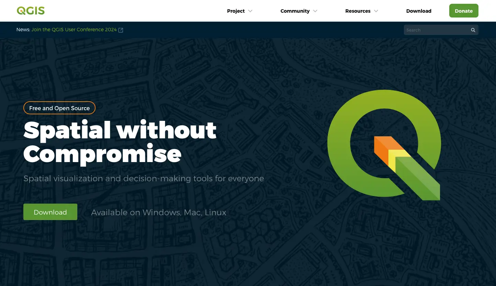

# 🌐 QGIS Website [](https://blog.qgis.org/2025/02/08/qgis-recognized-as-digital-public-good/)



> ## 👋 Welcome to QGIS.org!
>
> **This repository hosts the source code for the official QGIS Project website:**  
> 🌍 [https://qgis.org](https://qgis.org)
>
> Here you'll find everything you need to **build, develop, and contribute** to the QGIS website.
>
> ### ⚠️ Note on Subdomain Websites
>
> **This repository is _only_ for the main QGIS website ([qgis.org](https://qgis.org)).**
>
> If you are looking for the source code or want to contribute to QGIS subdomain websites, please visit their respective repositories below.  
> Each subdomain has its own codebase and contribution process:
>
> - [plugins.qgis.org](https://plugins.qgis.org) ([GitHub: QGIS-Plugins-Website](https://github.com/qgis/QGIS-Plugins-Website)) – QGIS Plugins Repository
> - [hub.qgis.org](https://hub.qgis.org) ([GitHub: QGIS-Hub-Website](https://github.com/qgis/QGIS-Hub-Website)) – QGIS Resources Hub
> - [feed.qgis.org](https://feed.qgis.org) ([GitHub: qgis-feed](https://github.com/qgis/qgis-feed)) – QGIS Feed Manager
> - [planet.qgis.org](https://planet.qgis.org) ([GitHub: QGIS-Planet-Website](https://github.com/qgis/QGIS-Planet-Website)) – QGIS Planet Blog Aggregator
> - [members.qgis.org](https://members.qgis.org) ([GitHub: QGIS-Members-Website](https://github.com/qgis/QGIS-Members-Website)) – QGIS Sustaining Members Portal
> - [certification.qgis.org](https://certification.qgis.org) ([GitHub: QGIS-Certification-Website](https://github.com/qgis/QGIS-Certification-Website)) – QGIS Certification Programme Platform
> - [changelog.qgis.org](https://changelog.qgis.org) ([GitHub: QGIS-Changelog-Website](https://github.com/qgis/QGIS-Changelog-Website)) – QGIS Changelog Manager
> - [conference.qgis.org](https://conference.qgis.org) ([GitHub: QGIS-UC-Website](https://github.com/qgis/QGIS-UC-Website)) – QGIS User Conference Website


<!-- TABLE OF CONTENTS -->
<h2 id="table-of-contents"> 📖 Table of Contents</h2>

<details open="open">
  <summary>Table of Contents</summary>
  <ol>
    <li><a href="#-project-overview"> 🚀 Project Overview </a></li>
    <li><a href="#-qa-status"> 🚥 QA Status </a></li>
    <li><a href="#-license"> 📜 License </a></li>
    <li><a href="#-folder-structure"> 📂 Folder Structure </a></li>
    <li><a href="#-using-ai-large-language-models"> 🤖 Using 'AI' (Large Language Models) </a></li>
    <li><a href="#-localization--build-docs"> 🌍 Localization & Build Docs </a></li>
    <li><a href="#️-scripts-overview"> 🛠️ Scripts Overview </a></li>
    <li><a href="#-using-the-nix-shell"> 🧊 Using the Nix Shell </a></li>
    <li><a href="#-contributing"> ✨ Contributing </a></li>
    <li><a href="#-have-questions"> 🙋 Have Questions? </a></li>
    <li><a href="#-contributors"> 🧑‍💻👩‍💻 Contributors </a></li>
  </ol>
</details>


## 🚀 Project Overview


## 🌍 Localization & Build Docs

- Internationalization and translation workflow: see [I18N.md](./I18N.md)
- Development and production build guide (including incremental per-language builds and media dedup): see [DEVELOPMENT.md](./DEVELOPMENT.md)
- Content authoring standards for i18n: use shortcode params with spaces around `=`, keep shortcode closing `>}}` on the same line, and do not use inline HTML in markdown files. See [I18N.md](./I18N.md) and [CONTRIBUTING.md](./CONTRIBUTING.md).


## 🚥 QA Status

### 🪪 Badges
| Badge | Description |
|-------|-------------|
| [](https://github.com/qgis/QGIS-Website/actions/workflows/playwright-e2e.yml) | End-to-end tests status (Playwright) |
| [](https://github.com/qgis/QGIS-Website/actions/workflows/github-pages.yml) | Deployment status to GitHub Pages |
| [](https://github.com/qgis/QGIS-Website/actions/workflows/check-site-links.yml) | Internal link check on the built site |
|  | Website availability status |
|  | Repository license |
|  | Open issues count |
|  | Closed issues count |
|  | Open pull requests count |
|  | Closed pull requests count |

### ⭐️ Project Stars

<a href="https://www.star-history.com/?repos=qgis%2FQGIS-Website&amp;type=date">
  <picture>
    <source media="(prefers-color-scheme: dark)" srcset="https://api.star-history.com/chart?repos=qgis/QGIS-Website&amp;type=date&amp;theme=dark&amp;legend=top-left" />
    <source media="(prefers-color-scheme: light)" srcset="https://api.star-history.com/chart?repos=qgis/QGIS-Website&amp;type=date" />
    
  </picture>
</a>


## 📜 License

This project is licensed under the MIT License. See the [LICENSE](./LICENSE) file for details.


## 📂 Folder Structure

```plaintext
QGIS-Website/
  ├── 🖼️  assets/           # Mainly used to store the schedule.csv file
  ├── ⚙️  config/           # Hugo configuration files
  ├── 📄  content/          # Markdown content files (pages, posts)
  ├── 🗄️  data/             # Data files (YAML, JSON, TOML) for site variables
  ├── 📚  docs/             # Project documentation
  ├── 🖼️  img/              # Images files used by this README
  ├── 🧩  layouts/          # Hugo templates and partials
  ├── 🧪  playwright/       # Playwright end-to-end test scripts
  ├── 📦  public/           # Generated site output (after `hugo` build)
  ├── 🗂️  resources/        # Hugo-generated resources (e.g., minified assets)
  ├── 🛠️  scripts/          # Utility scripts for development/maintenance/harvesting
  ├── 💻  source/           # Mainly used to store the qugsneews.atom file
  ├── 📄  static/           # Static files served as-is (e.g., favicon, robots.txt)
  ├── 🎨  themes/           # Hugo themes
  ├── ⚙️  config.toml       # Main Hugo configuration file
  ├── 🤝  CONTRIBUTING.md   # Contribution guidelines
  ├── 🐍  fetch_feeds.py*   # Script to get sustaining members and other feeds to update our web site
  ├── 📜  LICENSE           # Project license
  ├── ⚙️  Makefile          # Build/Deployment automation commands
  ├── 📖  README.md         # Project overview and instructions
  ├── 📋  REQUIREMENTS.txt  # Python dependencies (pip)
  ├── 🐚  flake.nix         # Nix flake (development environment)
  └── 💡  vscode.sh*        # VSCode helper script for the Nix development environment
```


## 🛠️ Scripts Overview

The `scripts/` folder contains utility scripts to assist with data loading, and project maintenance. Below is a summary of each script:


| Script Name                       | Description                                                                                  | Affected Website Parts |
|-----------------------------------|----------------------------------------------------------------------------------------------|------------------------|
| `fetch_feeds.py`                  | Simple script to get sustaining members and other feeds and update our web site with them     | 🏢 Sustaining Members page (`content/funders/`), 📰 News feeds (`data/feed.json`), 🎨 Flickr gallery (`content/flickr-images/`) |
| `vscode.sh`                       | Launch VSCode with all settings and extensions needed to productively work on this project    | 🛠️ Development environment only |
| `scripts/get_commit_hash.sh`  | Get the current commit hash of this repository and write it in `config/commit.toml` for the website version display | 📄 Footer version info across all pages |
| `scripts/changelog_harvest.py`  | Will create/update visual-changelogs at `content/project/visual-changelogs` based on the data at `data/conf.json` | 📋 Visual Changelogs pages (`/project/visual-changelogs/`) |
| `scripts/hub_images_harvest.py`  | Harvest maps/screenshots images from https://hub.qgis.org and update showcase content | 🗺️ Maps and Screenshots showcase section (`content/hub-maps/` and `content/hub-screenshots/`) |
| `scripts/resize_image.py`  | Contains utilities to optimize images (resize, transform to webp, check validity) | 🖼️ Images fetched automatically |
| `scripts/sanitize_commercial_supports.py`  | Checks each supporter's URL and removes invalid ones from commercial support listings | 🏪 Commercial Support page (`/resources/support/commercial-support/`) |
| `scripts/update_donors_from_file.py`  | Updates `data/donors.json` ordered alphabetically by first name based on input file | 💰 Donors page (`/funding/donate/`) |
| `scripts/update_donors.py`  | Updates `data/donors.json` ordered alphabetically by first name based on Stripe donations | 💰 Donors page (`/funding/donate/`) |
| `scripts/donor_exclusions.py`  | Removes names listed in the `EXCLUDED_DONORS` Actions variable from `data/donors.json` | 💰 Donors page (`/funding/donate/`) |
| `scripts/update-schedule.py`  | Updates `data/conf.json` and `content/schedule.ics` with release schedule information | 📅 Download page, Release schedule, LTR/LT version info |
| `scripts/update_individual_contributors.py`  | Aggregates GitHub stats for individual contributors across QGIS repositories | 👥 Individual Contributors section (`/community/organisation/contributors/`) |
| `scripts/update_contributing_orgs.py`  | Aggregates GitHub stats for contributing organizations across QGIS repositories | 🏢 Contributing Organizations section (`/community/organisation/organisations/`) |
| `scripts/match_commercial_contributors.py`  | Matches commercial support organizations with contributing organizations based on domain/name | 🏪 Commercial Support badges, 🏢 Contributing Organizations links |
| `scripts/update_user_groups.py`  | Builds the user groups list and map data from `data/user_groups/groups.json`: country names, continents, map points, country outlines and logos. Runs on pull requests (`--check`) and after merges. See [docs/user-groups.md](docs/user-groups.md) | 🌍 Local User Groups list and map (`/community/groups/list/`, `/community/groups/map/`) |
| **GitHub Actions (Automated)** | **Scheduled workflows for content updates** | **Multiple areas** |
| `.github/workflows/update-gh-sponsors.yml` | Updates GitHub Sponsors list twice daily | 💖 GitHub Sponsors page (`content/funding/donate/github-sponsors.md`) |
| `.github/workflows/update-donors.yml` | Updates Stripe donors list twice daily | 💰 Donors page (`data/donors.json`) |
| `.github/workflows/update-feeds.yml` | Updates feeds, hub maps, grant posts and contributor stats twice daily. Each script runs in its own job and commits its own changes, so a failing or slow script never holds back the others | 🏢 Funders, 📰 News feeds, 🗺️ Hub maps, 📰 Grant Programme pages |
| `.github/workflows/check-commercial-support-links.yml` | Sanitizes commercial support links weekly | 🏪 Commercial Support page |
| `.github/workflows/update-contributors.yml` | Runs the contributor, organization, and commercial-support-matching scripts twice daily | 👥 Contributors, 🏢 Organizations, 🏪 Commercial Support badges (`data/contributors/*.json`, `data/commercial_support/contributor_matches.json`) |
| `.github/workflows/update-user-groups.yml` | Builds the user groups data and logos after a change to `data/user_groups/groups.json` reaches `main`, commits it and redeploys | 🌍 Local User Groups (`static/data/user_groups/user_groups.json`, `data/user_groups/countries.json`, `static/img/user-groups/`) |

> ✏️ **Note:** Run each script from the project root. Some scripts may require environment variables or configuration—see comments within each script for usage details.


## 🧊 Using the Nix Shell

Please refer to the [Nix section](./CONTRIBUTING.md#nix) in [CONTRIBUTING.md](./CONTRIBUTING.md).


## ✨ Contributing

We welcome contributions! Please read the [CONTRIBUTING.md](CONTRIBUTING.md) for guidelines on how to get started.


## 🙋 Have Questions?

Have questions or feedback? Feel free to open an issue or submit a Pull Request!  


## 🧑‍💻👩‍💻 Contributors

- [Tim Sutton](https://github.com/timlinux) – Original author and lead maintainer of the QGIS Website project
- [Kontur Team](https://www.kontur.io) – Responsible for the design and development of the current website version
- [Lova Andriarimalala](https://github.com/Xpirix) – Core developer and ongoing maintainer
- [QGIS Contributors](https://github.com/qgis/QGIS-Website/graphs/contributors) – See the full list of amazing contributors who have helped make this website possible.


Made with ❤️ by Tim Sutton (@timlinux), Lova Andriarimalala (@Xpirix) and QGIS Contributors.
