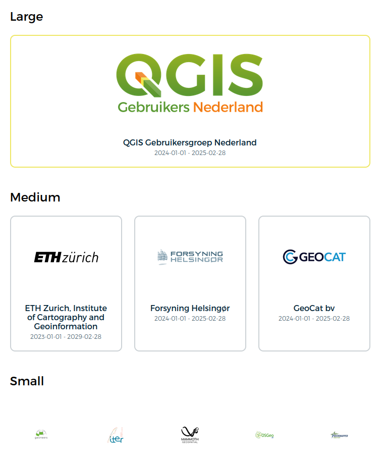

Detailed grid of supporters

`type` parameter may be:
- active - display all current QGIS supporters
- inactive - display past QGIS supporters
- changelog - display supporters of particular version

For some changelogs the list of supporters for particular version must be displayed. In this case funders are placed in the directory of that changelog. The format of each file is the same as in content/funders.

example of such changelog: content/project/visual-changelogs/visualchangelog30/funders/

Usage example:
```

```

`relativeImgPath` indicates that supporters logos are included in changelog dir.

`relativeImgPath` is false by default, the logos are taken from static/img/contributors in this case.

`level` shows a single membership level: `flagship`, `large`, `medium` or `small`. Leave it out to show every level. It works with `active` and `changelog`.

The visual changelogs from 3.34 onwards show only the flagship members:
```

```


